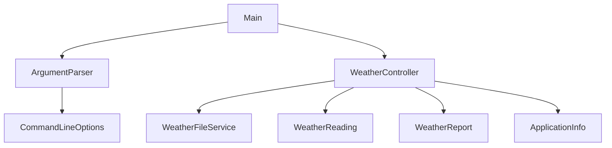

# Лабораторна №2 — класи, record та інкапсуляція

Варіант 18, метеостанція. CSV і звіт сумісні з [LAB_01](../LAB_01),
а записи представлені перевіреними незмінними об’єктами.
Потрібен JDK 21; встановлення та клонування описані в [кореневому README](../README.md).

Усі команди нижче виконуються **з кореня репозиторію**.

## Збірка

Linux / macOS:

```sh
./mvnw -B -pl LAB_02 -am verify
```

Windows PowerShell:

```powershell
.\mvnw.cmd -B -pl LAB_02 -am verify
```

`-pl LAB_02` вибирає модуль, `-am` також включає потрібні проєкти reactor.
Команда `./mvnw -B verify` або `.\mvnw.cmd -B verify` перевіряє обидві лабораторні.
`clean` за потреби додають перед `verify`; він видаляє попередній `target`.

## Запуск

```sh
java "-Dstdout.encoding=UTF-8" "-Dstderr.encoding=UTF-8" -jar LAB_02/target/lab02.jar --input LAB_02/data/input.csv --output LAB_02/out/report.txt
java -jar LAB_02/target/lab02.jar --version
java "-Dstdout.encoding=UTF-8" "-Dstderr.encoding=UTF-8" -jar LAB_02/target/lab02.jar --help
```

На Windows перед українським консольним виводом:

```powershell
[Console]::OutputEncoding = [System.Text.UTF8Encoding]::new($false)
```

Для окремої демонстрації першої лабораторної:

```sh
java "-Dstdout.encoding=UTF-8" "-Dstderr.encoding=UTF-8" -jar LAB_01/target/lab01.jar --input LAB_01/data/input.csv --output LAB_01/out/report.txt
```

Без параметрів обидві програми читають `data/input.csv` від поточної робочої
директорії; тому такий запуск виконується з папки відповідного модуля.
Батьківські папки звіту створюються автоматично, `--output report.txt` також працює.

## Дані та результати

Файл UTF-8, без заголовка, п’ять полів:

```text
date;temperature;humidity;pressure;wind
2026-09-01;-5.5;70.0;1013.0;3.2
```

Перший рядок блока — опис полів, його немає у [data/input.csv](data/input.csv).
Дата — текст YYYY-MM-DD; календарний розбір не виконується. Температура —
скінченне число °C; вологість — 0–100 %; тиск — додатне скінченне число гПа;
вітер — невід’ємне скінченне число м/с. NaN, нескінченності й порожні поля
відхиляються. Помилка містить номер рядка й причину; наступні записи обробляються.

Контрольний файл: 3 коректні записи, мінімум −5.50 °C, середня вологість 70.00 %,
максимальний вітер 7.50 м/с, 2 помилки. Без коректних даних — «Немає даних» і кількість 0.

## Структура та порядок читання коду

Усі класи містяться в `src/main/java/ua/lpnu/kzp/lab02/`.

| Файл | Що розібрати |
| --- | --- |
| [TemperatureHumidity.java](src/main/java/ua/lpnu/kzp/lab02/TemperatureHumidity.java) | record, незмінна пара, перевірки двох чисел |
| [WeatherReading.java](src/main/java/ua/lpnu/kzp/lab02/WeatherReading.java) | private final, конструктор, fromCsv, геттери, toString, builder |
| [WeatherReport.java](src/main/java/ua/lpnu/kzp/lab02/WeatherReport.java) | цикл за List<WeatherReading>, статистика й формат звіту |
| [ArgumentParser.java](src/main/java/ua/lpnu/kzp/lab02/ArgumentParser.java) | відомі параметри, перевірка значень, шляхи за замовчуванням |
| [CommandLineOptions.java](src/main/java/ua/lpnu/kzp/lab02/CommandLineOptions.java) | record із результатом аналізу аргументів |
| [WeatherFileService.java](src/main/java/ua/lpnu/kzp/lab02/WeatherFileService.java) | читання й запис UTF-8, створення папок |
| [ApplicationInfo.java](src/main/java/ua/lpnu/kzp/lab02/ApplicationInfo.java) | довідка й метадані версії |
| [WeatherController.java](src/main/java/ua/lpnu/kzp/lab02/WeatherController.java) | керування обробкою, помилки рядків, виклики моделі, звіту та файлового сервісу |
| [Main.java](src/main/java/ua/lpnu/kzp/lab02/Main.java) | лише виклик парсера, створення й запуск контролера, повідомлення про помилку параметрів |
| [WeatherReadingTest.java](src/test/java/ua/lpnu/kzp/lab02/WeatherReadingTest.java) | 12 прямих тестів нової моделі |
| [MainTest.java](src/test/java/ua/lpnu/kzp/lab02/MainTest.java) | 12 перенесених тестів поведінки |
| [ArgumentParserTest.java](src/test/java/ua/lpnu/kzp/lab02/ArgumentParserTest.java) | 6 тестів шляхів, режимів і хибних аргументів |
| [WeatherFileServiceTest.java](src/test/java/ua/lpnu/kzp/lab02/WeatherFileServiceTest.java) | 3 тести UTF-8, заміни вмісту й помилок файлів |

За уточненням викладача, починаючи з №2 Main є лише точкою запуску.
Він не містить циклу аргументів, файлових операцій або обробки CSV.



Контролер отримує перевірені параметри й керує роботою інших класів.
Файловий сервіс передає IOException контролеру; той окремо пояснює помилки
читання та запису. Main не друкує додаткового коду завершення: збережено
попередній консольний результат.

Фабрика перевіряє структуру й перетворює числа. Спільні методи валідації
дозволяють зберегти порядок помилок LAB_01, не дублюючи самі правила.
Конструктор завжди перевіряє стан, зокрема при прямому виклику або через builder.

## Builder — додаткове завдання

```java
WeatherReading reading = WeatherReading.builder()
        .date("2026-09-01")
        .temperature(-5.5)
        .humidity(70)
        .pressure(1013)
        .wind(3.2)
        .build();
```

Builder змінний, його використовують в одному потоці. Результат незмінний:
немає сеттерів, поля final, String і record не надають змінного внутрішнього стану.
Передавання готового вимірювання між потоками не потребує захисту від зміни
його полів. Builder не зберігається всередині результату; його подальші зміни
не впливають на створений об’єкт. Незадані числа — NaN, тому забуте поле не
підміняється випадковим коректним нулем.

## HTML-документація

Linux / macOS:

```sh
javadoc -Werror -encoding UTF-8 -charset UTF-8 -docencoding UTF-8 -d LAB_02/target/apidocs LAB_02/src/main/java/ua/lpnu/kzp/lab02/*.java
```

Windows PowerShell:

```powershell
$sources = @(Get-ChildItem LAB_02/src/main/java -Recurse -Filter '*.java' | ForEach-Object { $_.FullName })
javadoc -Werror -encoding UTF-8 -charset UTF-8 -docencoding UTF-8 -d LAB_02/target/apidocs @sources
```

Початкова сторінка — `LAB_02/target/apidocs/index.html`; clean видаляє її.

Версія LAB_02 — 1.1.1, LAB_01 — 1.0.0. Локально --version показує build local,
у GitHub Actions — номер запуску. [Тег v1.1.1](https://github.com/Layer2686/CPPT_Lazor_SV_KI-304_2/tree/v1.1.1),
[CI тега на трьох ОС](https://github.com/Layer2686/CPPT_Lazor_SV_KI-304_2/actions/runs/39641384246).
[Звіт](REPORT.md), [план та Issues](PLAN.md).

Архітектурне уточнення: [Issue #37](https://github.com/Layer2686/CPPT_Lazor_SV_KI-304_2/issues/37).
Версію v1.1.1 перевірено: 45 тестів, SpotBugs 0, обидва JAR і javadoc на трьох ОС.
